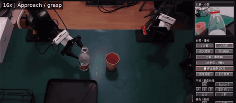
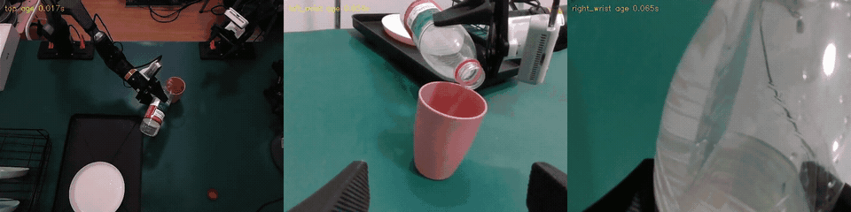

# PIPER CRAFT

面向真实双臂 Piper 的 RGB 桌面遥操作工具：Minecraft 风格键盘交互、三路RGB、本地 IK / 普通 MOVE_J 与控制器原生 MOVE_P 两种后端、单轴关节点动和整窗录像。

## 功能与边界

- W/S、A/D、Space/左Shift平移，I/K、J/L、O/P转向，Q/E夹爪，J1–J6按钮单轴点动，F9请求停止。
- 启动只观察；现场确认后显式进入控制。松键、失焦、菜单、切臂、切档及方案切换清除输入，不自动重放运动。
- SDK末端反馈为实读来源；本地FK仅用于IK及机器人几何。本地后端检查完整关节路径自碰撞，原生后端只检查当前几何，二者范围不同。
- 普通控制的关节速度和角度边界交控制器；本地保留加速度及跟随预算。原生平移可渐进调姿，依据实读控制器范围计算目标可达性，不覆盖主动转向。
- 不依赖深度、手眼或桌面标定，也不含桌面、物体或另一臂的环境碰撞模型。现场观察与人工停止仍是操作的一部分。

## 最近两次实机 Demo（2026-10-25）

两段均为通过PIPER CRAFT桌面控制真实机械臂的任务录像；本轮由Codex根据RGB逐步操作，用户进行现场确认。它们不是仿真，也不是端到端自主策略评测。

### Demo 1：首次倒水——有水入杯，少量洒水



[播放完整60秒片段](docs/assets/demo-01-first-pour.mp4)。使用顶视和持物腕画面观察，用户现场确认“杯内有水，桌面有少量水”。保留这一轮作为失败边界，不能标为零洒漏成功；片段裁取窗口上部以排除消息区，视频已压缩、无音频。

### Demo 2：另一腕相机辅助——本次无新增洒水



[播放完整50秒片段](docs/assets/demo-02-multi-view.mp4)。画面从左到右为顶视、左腕辅助视角、右腕持物视角。先把左腕调整到观察位并保持静止，再用右臂抓瓶；在未出水时对位，小步倾倒，左腕确认水流入杯后反转断流，观察残滴后撤并分步放瓶。用户现场确认“没有新增洒水”。

这一结果只代表当次任务；没有测量倒水体积、做对照实验或验证通用成功率，也不代表先前桌面水迹已清理。三路画面标注各自源帧年龄，不宣称硬件同步。更多边界见[实机经验](docs/field_notes.md)。

## 环境

原现场使用 Linux / ROS Noetic、SocketCAN、左右两台Piper和顶视/双腕RGB。桌面Python要求3.11及以上；机器人worker使用单独的SDK/模型环境，原现场为Python 3.9、Piper SDK 0.6.1、CasADi 3.6.7。它还需要可用的Pinocchio、HPP-FCL、NumPy、SciPy和PyYAML。这些环境与机器人描述文件不随仓库提供，需自行配置；其他固件/模型未声明通过实机验证。

安装桌面依赖（已安装uv）：

```bash
uv sync --python 3.11 --group dev
```

外部ROS工作区负责设备驱动、顶视RGB话题和 `cv_bridge` / `rospy` / `sensor_msgs`。腕相机由本项目的RGB worker按USB序列号读取V4L2彩色接口，不启动深度。

## 配置与启动

编辑 `config/devices.yaml`。仓库提供的是占位示例，须替换：

- `robot_python`、`rgb_python`、`ros_python`及 `ros_setup`；相对路径相对于项目根目录。
- `urdf` 和 `package_dirs`，指向自己提供的Piper描述及网格包。
- `arms.left/right`，指向现场正确的CAN接口。
- 三路相机USB序列号和ROS RGB话题；腕部匹配的是USB实际身份。
- `limits`中的夹爪行程等设备参数，以及 `config/tcp.json` 的真实工具变换。默认TCP在joint6零偏移，不等于实体瓶口或指垫。

控制速度、后端、按键和外观在 `config/teleop*.json` 中。先确认配置与现场一致，再启动：

```bash
./start.sh                   # worker和桌面；只观察
./start.sh --no-window       # 只启动观察worker
./start_teleop.sh            # 连接已有worker的桌面
```

`./start.sh`本身不会使能、回位或恢复旧输入；后续显式进入控制可能触发配置的起姿恢复，详见操作说明。配置更改不会自动重启既有worker，必须在确认停止并正确交接所有权后应用。

无需硬件的桌面演示：

```bash
uv run python -m astra_vla.teleop_desktop --demo
```

## 测试与操作记忆

```bash
uv run pytest -q
uv run python -m astra_vla.operation_memory compact
uv run python scripts/check_robot_memory.py
```

可选的GitHub Actions配置在 `docs/ci/offline-tests.yml`；复制到 `.github/workflows/offline-tests.yml` 后启用。

测试使用模拟SDK/临时socket或离线模型，不启动硬件控制。缺少机器人模型环境或本机原始操作记录的测试会跳过；离线测试不代表实机验收。操作记忆的规则随仓库共享，`state.json/current.md/problems.md`在首次compact时初始化，随后的现场状态只留本机。

录像和控制轨迹写入忽略的 `runs/`，运行socket及公开会话绑定在忽略的 `.runtime/`。新checkout不含凭据、设备私有身份、操作录像或原始会话历史。

[详细操作](docs/teleop.md) · [实机经验及限制](docs/field_notes.md) · [记忆维护规则](docs/memory/README.md) · [第三方组件](THIRD_PARTY_NOTICES.md)

## 许可证

本项目采用 [MIT](LICENSE)；外部SDK、ROS包、机器人描述和依赖保留各自许可证，见[第三方组件](THIRD_PARTY_NOTICES.md)。
